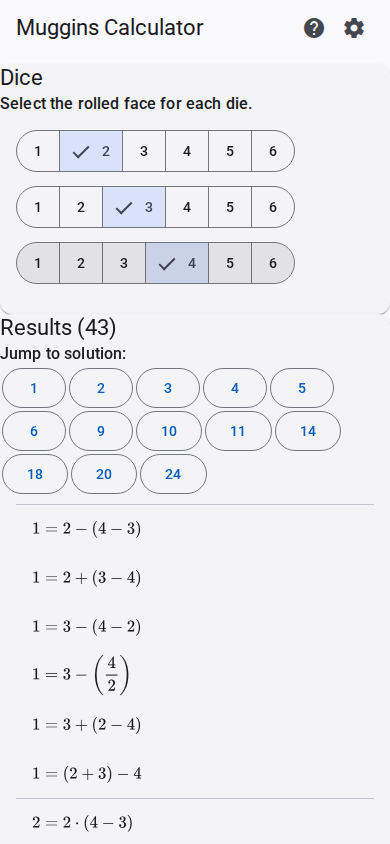
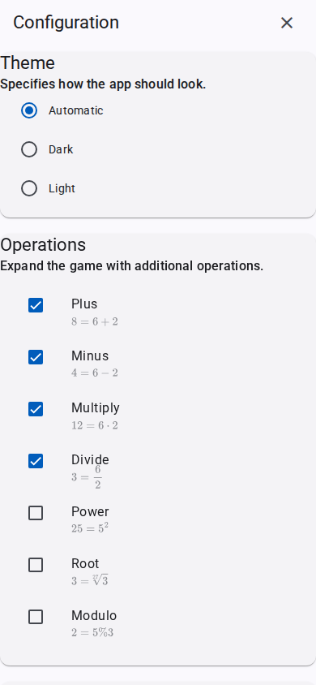

# Muggins Calculator  [](https://coveralls.io/github/vangorra/muggins_calculator)

An app for discovering and checking answers to the popular math board game Muggins.

[](https://vangorra.github.io/muggins_calculator/)

[](https://vangorra.github.io/muggins_calculator/) [](https://vangorra.github.io/muggins_calculator/)

[Muggins](https://www.mugginsmath.com/) is an amusing and challenging board game for any group of people.
Calculating answers and learning how other obtained answers is revealing and educational.
The game gets more interesting when one expands the game with additional operations, dice and placement locations.
This app provides the assistance and validation to using the standard game or any expansion.

Features:

- Human-readable equations with proper formatting and symbols.
- Supports default settings with a board numbered 1 through 36, 3 dice (6 faces each) and 4 operations (plus, minus, multiply, divide).
- Expand the game-play with additional operations (power, root, and modulo).
- Adjustable board size (placement locations) to any range of positive numbers.
- Customize the number of dice and the number of faces per die.
- Fast calculations using background processing.
- Instant results via precomputed solutions served as a compact binary file.
- Installable as a progressive web app (PWA) for offline use.

## Architecture

The project is an npm monorepo with three packages:

| Package | Purpose |
|---------|---------|
| `packages/ui` | Angular 21 web application with Material Design 3 |
| `packages/common` | Pure TypeScript equation solver, token encoding, and mugbin binary format |
| `packages/cli` | Node.js CLI for pre-generating solutions into `.mugbin` files |

### How It Works

1. **Offline**, the CLI generates all possible equations for each dice combination (e.g., all 3-dice rolls with 10-sided dice) and writes them into sharded `.mugbin` files — one per dice count (e.g., `solutions-3d.mugbin`). These are uploaded to a GitHub Release and downloaded during CI deployment.
2. **At runtime**, the UI serves these files statically. When a user selects dice faces, the `SolutionsService` uses HTTP Range requests to fetch only the relevant index entries and summary blocks from the appropriate shard — no full file download needed.
3. **Fallback**: If precomputed data isn't available (e.g., custom die sizes beyond what was generated), the UI falls back to computing equations on-the-fly using 4 persistent Web Workers with `comlink` RPC and `p-queue` concurrency control.

### UI Optimizations

- **Sharded files**: Solutions are split into one `.mugbin` file per dice count (e.g., `solutions-2d.mugbin`, `solutions-3d.mugbin`), so only the relevant shard is accessed.
- **HTTP Range requests**: Only the 16-byte header + compressed index are fetched on first load. Individual summary blocks (5 bytes per total/ops entry) and equation blocks are fetched on demand.
- **Gzip-compressed index & equations**: Both the index block and equation blocks are gzip-compressed, decompressed in the browser via `DecompressionStream`.
- **5-bit token encoding**: Each token (face value 1-10 or operation) is packed into 5 bits, reducing equation storage by ~40% compared to byte-per-token.
- **Lazy loading**: Equations for a specific total are only fetched and decompressed when the user clicks on that total.
- **Virtual scrolling**: Large equation lists use `@angular/cdk/scrolling` to render only visible items.
- **Persistent Web Workers**: 4 workers are created at startup and reused across calculations, avoiding worker creation overhead.

## Mugbin Binary Format

The `.mugbin` format is a compact binary file for storing precomputed equation solutions. It replaces the previous SQLite-over-HTTP approach with a simpler format optimized for HTTP Range requests.

### Why Mugbin?

- **No WASM dependency**: SQLite-over-HTTP required `sql.js-httpvfs` (~1MB WASM). Mugbin uses native browser APIs only.
- **Smaller payload**: 5-bit token packing + gzip compression produces smaller files than SQLite.
- **Fewer round-trips**: A single Range request fetches an entire summary block, vs. multiple SQL queries.
- **Simpler stack**: No virtual filesystem layer, no SQL parsing — just binary reads.

### File Layout

```
[Header: 16 bytes]
[Gzip-compressed index block: entryCount × 20 bytes]
[Data blocks: interleaved summary + gzip-compressed equations per entry]
```

Each dice count gets its own file (e.g., `solutions-3d.mugbin`).

#### Header (16 bytes)

| Offset | Size | Field | Description |
|--------|------|-------|-------------|
| 0-5 | 6B | magic | ASCII `"MUGBIN"` |
| 6 | 1B | format_version | Format version (currently `2`) |
| 7 | 1B | db_version | Schema version for app compatibility (currently `1`) |
| 8-11 | 4B | entry_count | Number of index entries (uint32LE) |
| 12-15 | 4B | compressed_index_size | Size of the gzip-compressed index block (uint32LE) |

#### Index Entry (20 bytes each, gzip-compressed as a block)

Entries are sorted by `faces_key`. All offsets are relative to the data section start (i.e., byte `16 + compressed_index_size`).

| Offset | Size | Field | Description |
|--------|------|-------|-------------|
| 0-3 | 4B | faces_key | Sorted face values packed as 5-bit tokens, zero-padded |
| 4 | 1B | faces_count | Number of dice (2-8) |
| 5 | 1B | reserved | Reserved (zero) |
| 6-9 | 4B | summary_offset | Byte offset of summary block, relative to data start (uint32LE) |
| 10-11 | 2B | summary_length | Summary block size in bytes (uint16LE) |
| 12-15 | 4B | equations_offset | Byte offset of compressed equations, relative to data start (uint32LE) |
| 16-19 | 4B | equations_length | Compressed equations size in bytes (uint32LE) |

#### Operations Bitmask

| Bit | Value | Operation |
|-----|-------|-----------|
| 0 | 1 | Plus (+) |
| 1 | 2 | Minus (-) |
| 2 | 4 | Multiply (\*) |
| 3 | 8 | Divide (/) |
| 4 | 16 | Power (^) |
| 5 | 32 | Root |
| 6 | 64 | Modulo (%) |

For example, an entry with `ops_mask = 5` contains equations using only plus and multiply.

#### Summary Block

Array of `(total: uint16LE, opsMask: uint8, count: uint16LE)` entries, sorted by `(total, opsMask)`. Each entry is 5 bytes.

Example: faces `[1,2,3]` with plus-only (mask=1) producing total 6 (5 equations):
```
06 00 01 05 00
```

- Bytes 0-1: total=6, Byte 2: opsMask=1 (plus), Bytes 3-4: count=5

The opsMask in summary entries enables per-operation filtering: when querying with a specific ops selection, the reader skips summary entries whose opsMask isn't a subset of the requested mask.

#### Equation Block

Gzip-compressed flat array of packed postfix equations, grouped in the same order as the summary entries. Each equation is `ceil((facesCount * 2 - 1) * 5 / 8)` bytes (5 bits per token, packed).

### 5-Bit Token Encoding

Each token in a postfix equation is encoded as a 5-bit value (0-31):

| Range | Meaning |
|-------|---------|
| 1-10 | Die face values |
| 11-24 | Reserved |
| 25 | Plus (+) |
| 26 | Minus (-) |
| 27 | Multiply (\*) |
| 28 | Divide (/) |
| 29 | Power (^) |
| 30 | Root |
| 31 | Modulo (%) |

Tokens are packed into bytes LSB-first. For a 3-dice equation with 5 tokens (3 faces + 2 operators), the packed size is `ceil(5 * 5 / 8) = 4` bytes.

**Example**: The postfix equation `1 2 + 3 *` (meaning `(1 + 2) * 3 = 9`) encodes as tokens `[1, 2, 25, 3, 27]`:
```
Tokens:     1        2        25       3        27
Binary:  00001    00010    11001    00011    11011
Packed into bytes (LSB-first):
  Byte 0: 00001|000 → bits from token 1 + start of token 2 → 0x42
  Byte 1: 10|11001|0 → end of token 2 + token 25 + start of token 3 → 0x64
  Byte 2: 0011|11011 → end of token 3 + token 27 → 0xD8,0x03
Result:  [0x42, 0x64, 0xD8, 0x03]
```

### Reading a Mugbin File (Pseudocode)

```
1. Fetch bytes 0-15 (header). Verify magic="MUGBIN", check db_version.
   Read compressed_index_size from bytes 12-15.
2. Fetch bytes 16..(16 + compressed_index_size - 1) (compressed index).
   Decompress with gzip to get entry_count × 20 bytes of index data.
   Add dataStart (= 16 + compressed_index_size) to all relative offsets.
3. To find results for faces=[1,2,3] with plus+minus (mask=3):
   a. Pack faces [1,2,3] into a 4-byte key using 5-bit encoding.
   b. Scan index for entries where facesKey matches (one entry per face combo).
   c. Fetch the summary block via Range request.
   d. Filter summary entries where (entry.opsMask & ~mask) == 0.
   e. Aggregate counts to get Map<total, equationCount>.
4. To get equations for a specific total (e.g., total=6):
   a. Fetch the compressed equation block via Range request.
   b. Decompress with gzip (browser: DecompressionStream, Node: zlib).
   c. Walk all summary entries to compute byte offset of matching entries.
   d. Extract equations from slices matching (total AND opsMask subset).
   e. Unpack 5-bit tokens and convert postfix to infix for display.
```

### Writer / Reader API (TypeScript)

**Writing a mugbin file:**

```typescript
import { MugbinWriter, packTokens, OPERATION_TO_TOKEN } from '@muggins_calculator/common';

const writer = new MugbinWriter();

// Add equations: faces, opsMask, total, packedEquationBytes, equationCount
const tokens = [1, 2, OPERATION_TO_TOKEN['plus']]; // postfix: 1 2 +
writer.addEquations([1, 2], 1, 3, packTokens(tokens), 1);

const fileData: Uint8Array = await writer.build();
// Write fileData to disk or serve via HTTP
```

**Reading a mugbin file:**

```typescript
import { MugbinReader, BufferDataSource } from '@muggins_calculator/common';

const reader = new MugbinReader(new BufferDataSource(fileData));
await reader.loadIndex(); // Decompresses gzip-compressed index

// Find entries for faces [1,2] (one entry per face combination)
const entries = reader.findEntries([1, 2]);

// Get jump data with opsMask filtering: Map<total, equationCount>
const opsMask = 1; // plus only
const jumpData = await reader.getJumpData(entries, opsMask);
// jumpData.get(3) → 1 (one equation produces total 3)

// Get equations for a specific total, filtered by opsMask
const equations = await reader.getEquationsForTotal(entries, 3, opsMask);
// equations[0].postfixTokens → [1, 2, 25] (1 2 +)
```

**HTTP Range-based reading (browser):**

```typescript
class FetchDataSource implements MugbinDataSource {
  constructor(private url: string) {}
  async readBytes(offset: number, length: number): Promise<Uint8Array> {
    const response = await fetch(this.url, {
      headers: { Range: `bytes=${offset}-${offset + length - 1}` },
    });
    return new Uint8Array(await response.arrayBuffer());
  }
}

// Each dice count has its own file
const reader = new MugbinReader(new FetchDataSource('/solutions-3d.mugbin'));
await reader.loadIndex(); // Fetches header + compressed index via Range requests
```

## Development

### Setup

The application is an Angular project written in TypeScript, organized as an npm monorepo with `packages/ui`, `packages/common`, and `packages/cli` workspaces.

```shell
npm install
npm start
```

### Commands

```shell
npm start          # Start dev server (http://localhost:4200)
npm test           # Run unit tests (UI + solver + CLI)
npm run e2e        # Run Playwright end-to-end tests
npm run build      # Production build
npm run format     # Run Prettier
```

### Generating Precomputed Solutions

The CLI pre-generates all possible equations for given die configurations into sharded `.mugbin` files (one per dice count):

```shell
# Generate solutions for 3 six-sided dice (creates solutions/solutions-3d.mugbin)
npm run generate-all-solutions -- "6,6,6"

# Or run the CLI directly with a custom output directory
npm run build -w packages/common -w packages/cli
node packages/cli/dist/main.js generate-all-solutions --outputDir ./my-output --dieSize "6,6,6"

# Generate for a single face combination
node packages/cli/dist/main.js generate-solutions --output single.mugbin --faces "1,2,3"
```

The `generate-all-solutions` command writes to the `solutions/` directory by default and automatically names the output file `solutions-Nd.mugbin` based on the number of dice. The full output path is printed when generation completes. The CLI spawns parallel workers (one per CPU core minus 2) to solve each face combination. Generation supports resumability — if interrupted, re-running the same command skips already-completed face combinations.

### Deploying Precomputed Solutions

Solution files are stored as GitHub Release assets (not in git history) and downloaded during CI deployment. This keeps large binary files out of source control.

**First-time setup:**

```shell
# Generate all solution files locally
npm run generate-all-solutions -- "10,10"
npm run generate-all-solutions -- "10,10,10"
npm run generate-all-solutions -- "10,10,10,10"
# ... etc for each dice count

# Create the release with solution files
npm run create-solutions-release
```

**Updating solutions after regenerating locally:**

```shell
# Upload new files to the existing release (overwrites existing assets)
npm run upload-solutions
```

The publish workflow automatically downloads these files from the `solutions-latest` release and copies them into the build output before deploying to GitHub Pages. If no release exists, the site deploys without precomputed solutions (the UI falls back to local Web Worker computation).

### Dev Server & Proxy

During development, `npm start` runs two processes:

1. **Solutions server** (`serve-solutions.js`): HTTP server on port 4250 that serves `solutions-*d.mugbin` files from a directory with Range request support.
2. **Angular dev server** (`ng serve`): Proxies `/solutions-*d.mugbin` requests to the solutions server via `proxy.conf.js`.

### Unit Testing

```shell
npm test                            # All packages
npm run test -w packages/ui         # UI only
npm run test -w packages/common     # Solver only
npm run test -w packages/cli        # CLI only
```

### End-to-End Testing

E2E tests use Playwright and run against a production build in both desktop (1280x720) and mobile (390x844) viewports. Screenshots are committed to the repository and validated on each run.

```shell
npm run e2e

# Update snapshots after intentional visual changes
cd packages/ui && npx playwright test --update-snapshots
```
